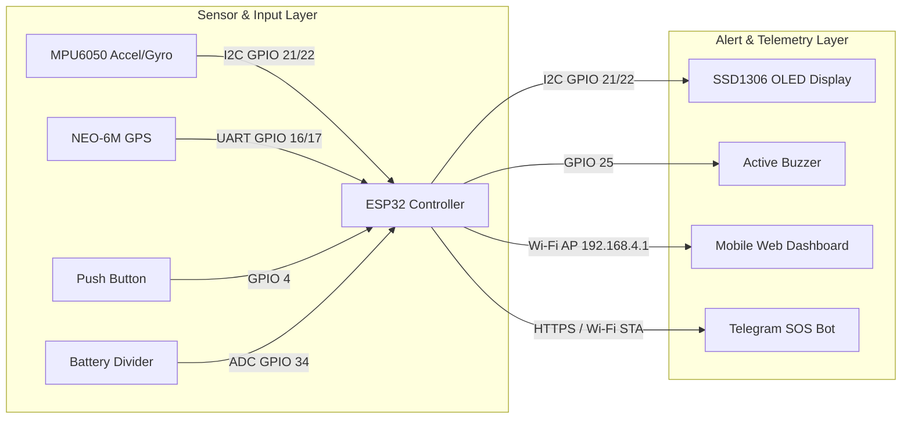

<div align="center">

# 🛡️ AEGIS RIDE
### Smart Vehicle Safety & Road Condition Telemetry System

**An ESP32-based IoT project for road-event monitoring, crash detection, rider alerts, and emergency SOS communication.**


</div>

---

## 👥 Project Authors

| Profile | Author Name | Role & Focus | GitHub Profile |
| :---: | :--- | :--- | :--- |
|  | **Thillai Nathan** | Embedded Firmware, Telemetry & IoT Architecture | [@thillai-nathan](https://github.com/thillai-nathan) |
|  | **Fathima Asrah** | Hardware Integration, Validation & Documentation | [@fathimaaaaa3](https://github.com/fathimaaaaa3) |

### 🤝 Contributors
<a href="https://github.com/thillai-nathan/aegis-ride/graphs/contributors">
  
</a>

---

## 📌 About the Project

**AEGIS RIDE** is an IoT-based vehicle safety prototype designed to monitor vehicle motion, identify potential road hazards, and assist riders during emergency situations.

The system uses an **ESP32 microcontroller** to process sensor readings, display information on an OLED screen, and provide a web-based dashboard for monitoring vehicle telemetry. When an emergency is triggered, the system can attempt to send an SOS alert through Telegram when an internet connection is available.

---

## 🏗️ System Architecture



---

## 🎯 Objectives

- Detect and classify road impacts using motion-sensor data.
- Identify speed breakers and significant vehicle tilting.
- Monitor vehicle movement and available battery information.
- Obtain rider coordinates using a GPS module or supported phone-location integration.
- Provide a manual SOS trigger and countdown cancellation.
- Display live telemetry and recent events on a mobile-friendly dashboard.
- Send emergency notifications through Telegram when connectivity permits.

---

## 🧰 Hardware Components

| Component | Interface | Purpose |
|---|---|---|
| **ESP32 Dev Module** | Dual-Core MCU | Main controller and Wi-Fi connectivity |
| **MPU6050** | I2C (`0x68`) | 6-axis acceleration and orientation measurements |
| **NEO-6M GPS** | UART (`9600 baud`) | Outdoor positioning and speed data |
| **SSD1306 OLED** | I2C (`0x3C`) | Local status and event display |
| **Buzzer** | Digital Out | Audible warnings and SOS countdown beeps |
| **Push Button** | Digital In (`INPUT_PULLUP`) | Manual control and SOS interaction |
| **Battery Voltage Divider** | Analog ADC | Battery-voltage measurement |

---

## 💻 Software and Technologies

- Arduino IDE
- ESP32 Arduino framework
- Embedded C++
- HTML, CSS and JavaScript
- HTTP web server
- Wi-Fi access point and station modes
- Telegram Bot API
- Google Maps location links

---

## ⚙️ System Workflow

1. **Initialization:** The ESP32 initializes the sensors and display.
2. **Data Acquisition:** The MPU6050 supplies acceleration and orientation measurements.
3. **Hazard Classification:** The firmware processes the readings to identify possible road events.
4. **Live Visualization:** Telemetry and event information are displayed on the OLED and web dashboard.
5. **Emergency Trigger:** A detected emergency or manual SOS action initiates the configured alert process.
6. **Remote Dispatch:** The firmware attempts Telegram delivery when internet access is available.
7. **Rider Override:** The rider can cancel an eligible countdown or dismiss the displayed SOS status.

---

## 🚨 Sample Emergency Telegram Alert

When an uncancelled crash or manual SOS is triggered with active internet connectivity, the Telegram Bot dispatches an alert in this format:

```text
🚨 AEGIS RIDE - EMERGENCY SOS TRIGGERED! 🚨
-----------------------------------------
⚠️ Event: Severe Impact / Crash Detected
🔋 Battery Level: 84% (3.98V)
📐 Tilt Angle: 64.2° | Impact: 3.4G
📍 Location: 13.0827° N, 80.2707° E
🗺️ Maps Link: [https://maps.google.com/?q=13.0827,80.2707](https://maps.google.com/?q=13.0827,80.2707)
⏱️ Status: Rider did not cancel countdown. Immediate check required!
```

---

## 🌐 Web Dashboard

The dashboard implemented in the firmware provides:

- Live sensor telemetry
- Emergency SOS and cancellation controls
- Battery information
- GPS and location information
- Google Maps link
- Recent event history
- Last-event display

**Local access:** Connect to the ESP32 access point and open `http://192.168.4.1` in a browser.

> **Note:** Remote Telegram delivery requires a separate working internet connection for the ESP32. Local dashboard access alone does not guarantee that an emergency message will reach another person.

---

## 🔌 Pin Connections

| Module | ESP32 Connection | Protocol / Note |
|---|---|---|
| MPU6050 SDA | `GPIO 21` | Shared I2C Data |
| MPU6050 SCL | `GPIO 22` | Shared I2C Clock |
| OLED SDA | `GPIO 21` | Shared I2C Data |
| OLED SCL | `GPIO 22` | Shared I2C Clock |
| GPS TX | `GPIO 16` | Connects to ESP32 `RX2` |
| GPS RX | `GPIO 17` | Connects to ESP32 `TX2` |
| Buzzer positive | `GPIO 25` | Active alert output |
| Push button | `GPIO 4` and `GND` | Active-Low manual trigger |
| Battery sensing | `GPIO 34` | Through a suitable voltage divider |

---

## 🚀 Setup Instructions

1. Install the Arduino IDE and ESP32 board support.
2. Open the project firmware in the Arduino IDE.
3. Verify the wiring and sensor connections.
4. Configure Wi-Fi and Telegram credentials privately; do not commit secrets to GitHub.
5. Select the correct ESP32 board and serial port.
6. Upload the firmware.
7. Open Serial Monitor at `115200` baud.
8. Connect your phone to the configured ESP32 access point.
9. Open `http://192.168.4.1` to access the dashboard.
10. Test each feature individually before performing integrated tests.

---

## 🧪 Testing and Validation

Record the actual results of these tests:

- [ ] MPU6050 initialization and changing sensor readings
- [ ] GPS fix and coordinate validation
- [ ] OLED status updates
- [ ] Road-event classification
- [ ] Manual SOS activation
- [ ] Countdown cancellation
- [ ] Telegram delivery with internet access
- [ ] Dashboard operation during sensor activity
- [ ] Battery-voltage measurement

Do not report detection accuracy or successful emergency delivery until the corresponding tests have been completed.

---

## 🔐 Security Considerations

- Keep Wi-Fi passwords and Telegram tokens out of public source code.
- Use certificate verification for HTTPS requests.
- Validate dashboard commands and incoming data.
- Test the system in a controlled environment.
- Do not rely on this academic prototype as the sole means of emergency protection.

---

## 🔮 Future Enhancements

- Improve crash-detection reliability through repeated testing.
- Add persistent event history and downloadable reports.
- Develop a companion mobile application.
- Improve GPS diagnostics and location freshness indicators.
- Add sensor-health monitoring and low-battery warnings.
- Improve dashboard accessibility and responsive design.
- Evaluate detection performance using recorded test data.

---

## ⚠️ Disclaimer

**AEGIS RIDE** is an academic prototype. Its alerts, sensor readings, location estimates, and network delivery depend on hardware performance and connectivity. It is not a certified vehicle safety or emergency-response system.
